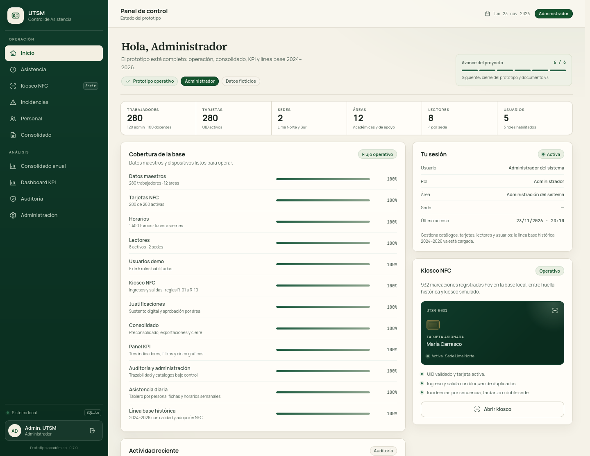
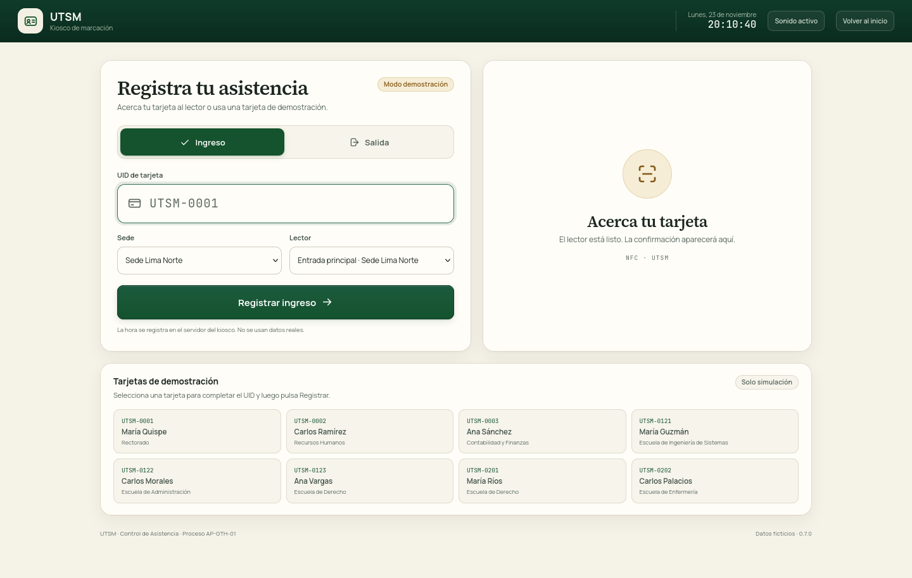
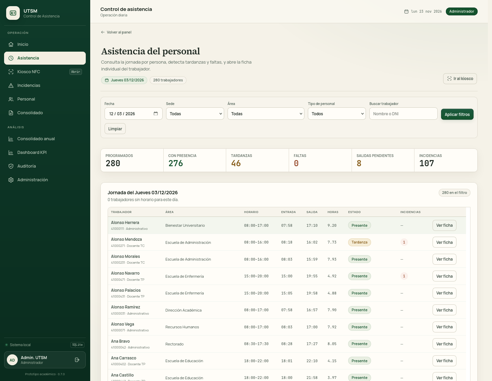
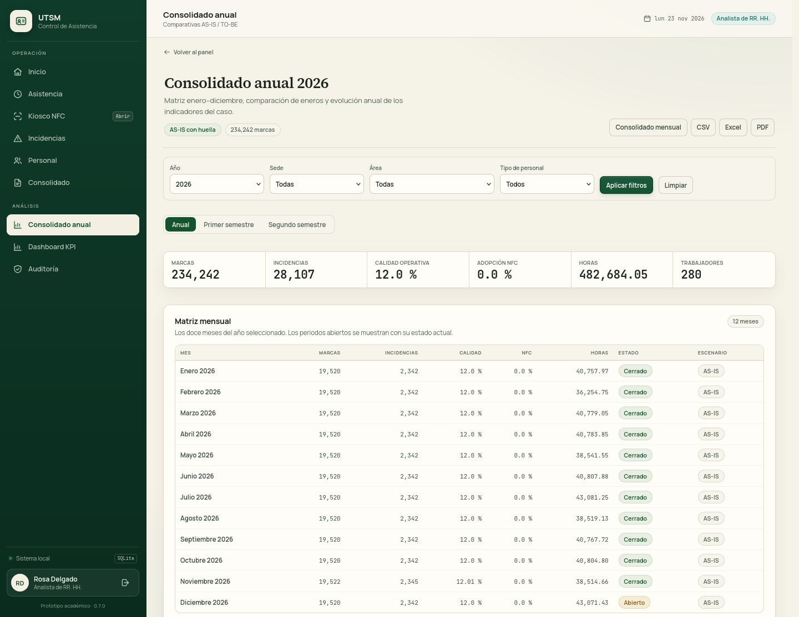
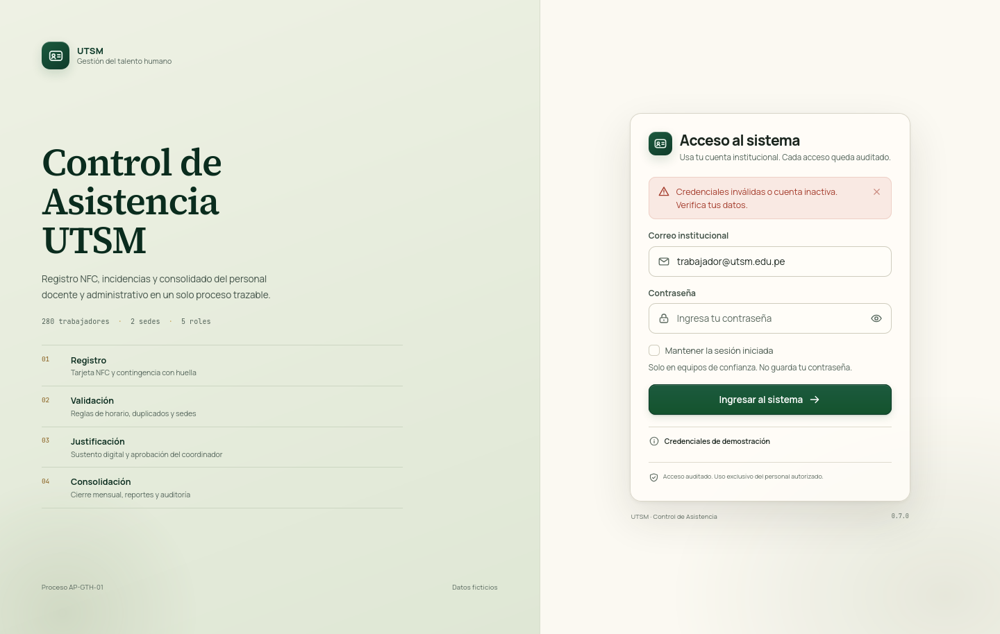
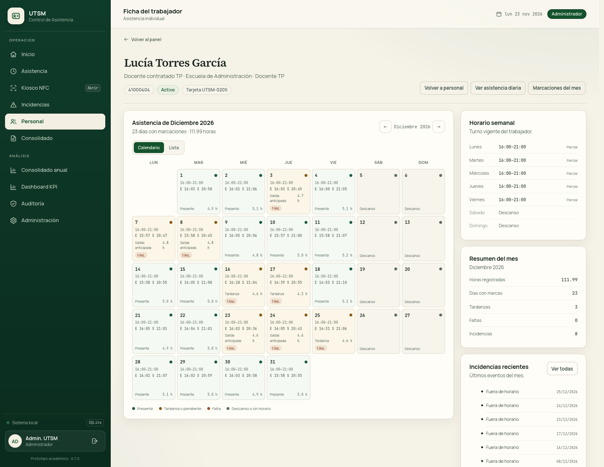
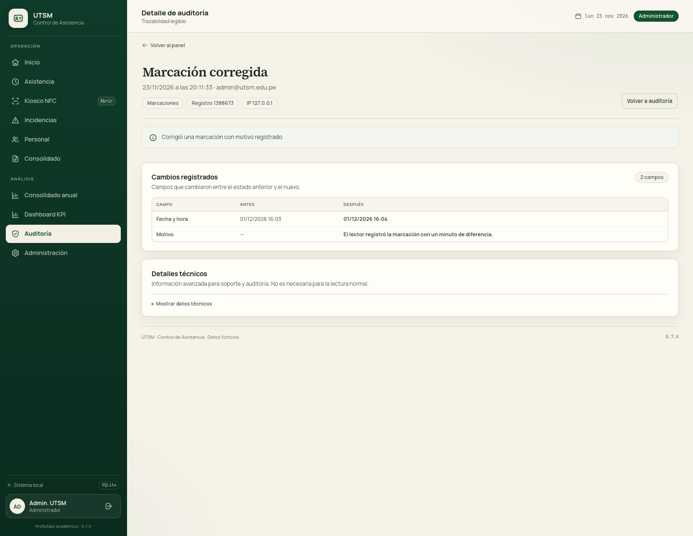

# UTSM NFC Attendance — Attendance Control with NFC Cards

A local attendance-control prototype for the fictional **Universidad Tecnológica San Martín (UTSM)**, a two-campus institution. It registers NFC card check-ins, classifies incidents, receives digital justifications, consolidates monthly and annual reports, and records every change in an audit log.

> Academic project with fictitious data. It is not a real deployment and does not process personal information.


<p align="center">
  
  
</p>
<p align="center">
  
  
</p>

## Demo Access

| Role | Email | Password |
|---|---|---|
| Administrator | `admin@utsm.edu.pe` | `admin123` |
| HR Manager | `jefe@utsm.edu.pe` | `jefe123` |
| HR Analyst | `analista@utsm.edu.pe` | `analista123` |
| Area Coordinator | `coordinador@utsm.edu.pe` | `coordinador123` |
| Employee | `trabajador@utsm.edu.pe` | `trabajador123` |

The **Administrator** account can explore every module. The HR Analyst works with attendance, people, annual reports and the audit log. The Area Coordinator only sees their own area, and the Employee only sees their own record.

## Highlights

- **NFC kiosk** with demo cards, duplicate blocking, on-screen confirmation and ten business rules.
- **Daily attendance** for both campuses, with a monthly employee file, calendar view, list view and weekly schedules.
- **Incidents and justifications**: employees upload a digital support file, the coordinator approves or rejects it, and every step is audited.
- **Monthly close**: pre-consolidation with pending exceptions, manager authorization and CSV, Excel and PDF outputs.
- **Annual consolidation**: January–December matrix, January vs January, year vs year, filters and a semester view.
- **Manual mark correction** with a mandatory reason, automatic incident closure and before/after audit.
- **Readable audit log**: who did what, when, from which IP, and which fields changed.
- **Role-based access** for Administrator, HR Manager, HR Analyst, Area Coordinator and Employee.
- **Security controls**: five failed attempts trigger a 15-minute lock, 30-minute idle session, hashed passwords, `HttpOnly` and `SameSite` cookies, and basic security headers.

## How It Works

```text
NFC card → reader → API → business rules → mark / incident → justification → consolidation → close
```

1. The kiosk sends the card UID and the system checks that the card is active.
2. Business rules validate duplicates, tolerance, double check-in at two campuses and schedule.
3. If something does not match, an incident is created and the employee can justify it.
4. The coordinator resolves the justification; the analyst corrects remaining exceptions.
5. The HR manager authorizes the monthly close and the period files are generated.
6. The annual report compares the baseline, the target and the simulated scenario.

### Business Rules

| Rule | What it controls |
|---|---|
| R-01 | Only active cards. |
| R-02 | Duplicate blocking within a 2-minute window. |
| R-03 | 10-minute tolerance against the schedule. |
| R-04 | Missing or out-of-schedule check-ins and check-outs. |
| R-05 | 5 business days to submit a justification. |
| R-06 | Coordinators only resolve incidents from their own area. |
| R-07 | A closed period rejects changes. |
| R-08 | A lost card is blocked. |
| R-09 | Alert when the same person checks in at two campuses within 30 minutes. |
| R-10 | The real device timestamp is preserved. |

### Architecture

- **Flask** with blueprints per module: auth, kiosk, incidents, attendance, reports, dashboard, audit, admin and main.
- **SQLAlchemy + SQLite** with 14 tables: campuses, areas, employees, cards, schedules, readers, marks, incidents, justifications, users, audit, periods, consolidations and indicators.
- **Jinja2 + custom CSS** using the “Paper, forest and brass” visual system; Chart.js is served locally.
- **WeasyPrint and openpyxl** for PDF and Excel exports.
- **pytest** for process rules and **Selenium** for visual evidence.

### Data Scenarios

| Period | Scenario | Check-in method |
|---|---|---|
| 2024–2026 | AS-IS baseline | Fingerprint, 0 % NFC |
| January 2027 | TO-BE simulation | NFC card, 95 % adoption |
| 2027 annual | TO-BE target | Not a measurement |

The demo database holds **280 employees**, **2 campuses**, **722,242 marks**, **96,034 incidents** and **37 monthly periods**. Values from 2024 to 2026 are case parameters; January 2027 is a simulation.

## Tech Stack

- Python 3.11+ · Flask 3 · SQLAlchemy · Flask-Login · Flask-WTF
- SQLite · Jinja2 · custom CSS · local Chart.js
- WeasyPrint · openpyxl
- pytest · Selenium · ruff

## Project Structure

```text
.
├── app/
│   ├── auth/           # sign-in, lockout and session audit
│   ├── kiosk/          # NFC check-in and rules R-01 to R-10
│   ├── incidents/      # incidents, justifications and approvals
│   ├── attendance/     # daily board, people, employee files and schedules
│   ├── reports/        # pre-consolidation, close, annual report and exports
│   ├── dashboard/      # KPIs, historical series and operation
│   ├── audit/          # readable event log and CSV export
│   ├── admin/          # catalogs, cards, readers and users
│   ├── main/           # home and base pages
│   ├── templates/      # Jinja2
│   └── static/         # CSS, JS, fonts and Chart.js
├── seeds/              # master and historical data
├── tests/              # 135 tests
├── scripts/            # validation, QA, screenshots and migration
├── docs/
│   ├── capturas/v7/    # 31 screenshots + manifest
│   ├── readme/         # images used in this README
│   └── v7/             # document-to-database correlation report
├── schema.sql
├── Makefile
├── requirements.txt
└── run.py
```

## Run Locally

Requires Python 3.11 or newer.

```bash
git clone https://github.com/AdrianChavezHuaman/utsm-nfc-attendance.git
cd utsm-nfc-attendance

python3 -m venv .venv
.venv/bin/pip install -r requirements.txt

# Master data: campuses, areas, 280 employees, cards and users
.venv/bin/flask --app run.py bootstrap

# Baseline 2024-2026 + simulated January 2027 (may take a few minutes)
make seed-historico

# Local server
.venv/bin/python run.py
```

Open **http://127.0.0.1:5000**.

Equivalent shortcuts:

```bash
make setup
make bootstrap
make seed-historico
make run
```

## Data and Demo Behavior

- The database is **SQLite**, stored locally under `instance/` and excluded from the repository.
- Seed data covers **2024–2026** as the AS-IS baseline and **January 2027** as a TO-BE simulation.
- All names, emails, cards and marks are fictitious.
- There is **no real NFC reader**: the kiosk uses demo cards.
- The project does **not** integrate with payroll or the academic system.
- The improvement is a **design estimate**, not a measured result; an eight-week pilot is left as future work.

## Tests and Quality

```bash
make test                 # 135 tests
make smoke                # 24 end-to-end checks
make validar-historico    # correlation against the case baseline
make shots-v7             # annex screenshots (server required)
```

- **135 tests** covering auth, rules, kiosk, incidents, reports, KPIs, audit, admin and historical data.
- **24/24** smoke checks.
- **Visual QA** at 1440, 390 and 320 px with no horizontal overflow.
- **Readable audit** with a human explanation and collapsed technical JSON.

## Security

<p align="center">
  
</p>

- Five failed attempts lock the account for 15 minutes and write a `LOGIN_BLOQUEADO` audit event.
- Sessions expire after 30 minutes of inactivity.
- Passwords are stored as hashes; the app never stores plain text.
- Private pages send `Cache-Control: no-store`.
- Responses include `X-Content-Type-Options`, `X-Frame-Options`, `Referrer-Policy` and `Permissions-Policy`.
- A single error message avoids revealing whether an email exists.

## Documentation

- `docs/capturas/v7/`: 31 screenshots and `MANIFIESTO.md` with the APA figure proposal (A1–A31).
- `docs/v7/CORRELACION.md`: document-to-database control of every key figure.
- `DESIGN.md`: visual tokens and interface criteria.
- The academic report is delivered separately.

<p align="center">
  
  
</p>

## Limitations

- **Fictitious data**: UTSM does not exist and the figures are not real measurements.
- **No real NFC hardware**: the kiosk uses demo cards.
- **Local only**: no hosting, PostgreSQL or payroll integration.
- **No live demo on GitHub Pages**: this is a Flask app and needs a running server.
- **Academic scope**: the improvement is projected, not proven.

## Español

Prototipo local de control de asistencia para la UTSM, una institución ficticia de dos sedes. Registra marcaciones con tarjeta NFC, clasifica incidencias, recibe justificaciones digitales, consolida el mes y el año, y audita cada cambio. Incluye kiosco, asistencia diaria, fichas por trabajador, horarios semanales, cierre mensual, consolidado anual, corrección de marcas y control de acceso por roles. Está construido con Flask, SQLite, Jinja2 y Chart.js, con 135 pruebas y 24 comprobaciones de extremo a extremo. Todos los datos son ficticios y la mejora es una estimación de diseño, no una medición real.

## Author

**Adrian Chavez Huaman** · [GitHub](https://github.com/AdrianChavezHuaman)

Academic project, Faculty of Engineering and Architecture. Educational use.
